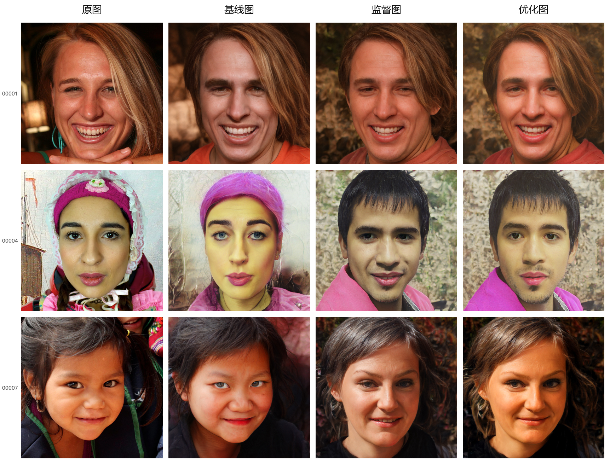

# Image-Generation-Group-14 · V3

人脸匿名化 V3，输出四列：**原图、基线图、监督图、优化图**。保留视线约束，加入较弱的原图面颊色度约束以减轻发灰，取消肩颈布局约束。全部网络冻结，只优化潜码。



## 1. 安装环境

已验证：Windows、Python 3.13、PyTorch 2.8.0、torchvision 0.23.0、NVIDIA GPU（6 GB 显存）。

```powershell
git clone https://github.com/toxcyww/Image-Generation-Group-14.git
cd Image-Generation-Group-14
python -m pip install torch==2.8.0 torchvision==0.23.0 --index-url https://download.pytorch.org/whl/cu126
python -m pip install -r requirements.txt
```

## 2. 放置模型权重

**预训练权重合计约 1.62 GB，体积较大，未上传 GitHub。** 下载代码后须补齐下列六个文件；本地完整 V3 包已包含它们。程序不自动联网下载。保存路径均相对于项目根目录，缺少的文件夹自行创建。

| 权重 | 下载来源 | 保存路径 |
| --- | --- | --- |
| e4e FFHQ，含 StyleGAN2 | [权重镜像](https://huggingface.co/AIRI-Institute/HairFastGAN/resolve/47855f8ea72b02294649385211a1ae1fd7dcb58e/pretrained_models/encoder4editing/e4e_ffhq_encode.pt) | `models/e4e_ffhq_encode.pt` |
| SimSwap ArcFace | [官方说明](https://github.com/neuralchen/SimSwap/blob/main/docs/guidance/preparation.md#pretrained-model)，下载 `arcface_checkpoint.tar` | `models/arcface_checkpoint.tar` |
| YuNet | [OpenCV Zoo](https://media.githubusercontent.com/media/opencv/opencv_zoo/main/models/face_detection_yunet/face_detection_yunet_2023mar.onnx)，重命名为 `yunet.onnx` | `models/yunet.onnx` |
| 3DDFA-V2 MobileNet | [官方权重](https://raw.githubusercontent.com/cleardusk/3DDFA_V2/master/weights/mb1_120x120.pth) | `third_party/tddfa/weights/mb1_120x120.pth` |
| 2D-FAN4 | [官方权重](https://www.adrianbulat.com/downloads/python-fan/2DFAN4-11f355bf06.pth.tar) | `models/2DFAN4-11f355bf06.pth.tar` |
| L2CS Gaze360 | [固定版本 safetensors 权重](https://huggingface.co/py-feat/l2cs/resolve/241076966f03b197773ce75d23adc60299473ccd/l2cs_gaze360_resnet50.safetensors) | `models/l2cs_gaze360_resnet50.safetensors` |

检查文件及 SHA256：

```powershell
python -B infer.py --check-models
```

V3 不需要 V2 的 LPIPS、SqueezeNet 权重。3DDFA 的小型归一化配置已附带。来源和许可证见 [third_party/NOTICES.txt](third_party/NOTICES.txt)。

## 3. 运行

输入清晰、方形的人脸裁剪图，输出目录须尚不存在。

单张图片：

```powershell
python -B infer.py --input "人脸.png" --output "outputs/result_01" --device cuda
```

批量处理：

```powershell
python -B infer.py --input "人脸文件夹" --output "outputs/batch_01" --device cuda
```

支持 PNG、JPG、JPEG、BMP、WebP，批量文件名去掉扩展名后须互不重复。每张图片生成基线和优化结果各 200 步。

运行后查看：

- `comparison.jpg`：原图、基线图、监督图、优化图。
- `baseline.png`、`teacher.png`、`final.png`：对应单张结果。
- `latent.pt`：优化图的潜码；`result.json`：运行记录。

基线从原图反演潜码开始，使用原图属性、眼口、原身份抑制和正则；潜码正则仍参考监督图潜码。优化图从生成监督图时保留的潜码开始，增加监督图匿名身份特征、视线及原图面颊色度约束，不重新编码监督图。

本地完整包的 `results/` 保存本次三张结果，GitHub 提供上方的 `示例.jpg`。示例来自当前三张开发样本；第三张仍偏暖，眼口和视线仍有误差。重复优化可能因浮点计算产生差异。
